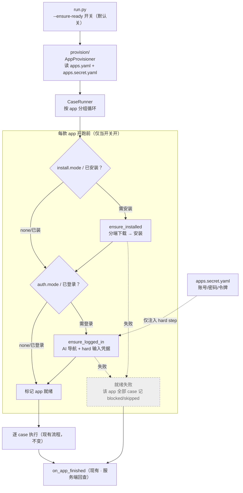

# 环境就绪（安装 / 登录）扩展设计

> **状态**：设计稿（仅定义目录结构、Schema、安全约束与分阶段计划，暂不含实现）。
> **定位**：为「被测软件未安装 / 未登录」两个未来场景预留兼容能力，且**默认关闭、不影响现有 case**。
> **前置阅读**：[tech_design.md](./tech_design.md)（硬约束、验收/报告机制）、[架构图集](./tech_design_diagrams.md)。

---

## 1. 背景与目标

现有所有 case 都隐含一个前提：**目标软件已安装且已登录**，执行链路直接从「操作界面」开始。
未来会遇到两类新场景：

1. **软件未安装** —— 需要按平台下载并安装后再跑 case。
2. **软件未登录** —— 需要先用账号密码（或人工）完成登录再跑 case。

同时还有第三类需要显式表达：**部分软件免安装 / 免登录**（如系统自带浏览器），这类应能被「标记跳过」。

**设计目标**：

- 用**独立、可选、app 级**的「环境就绪保障」能力兼容上述场景，**开关默认关**，关时老 case 行为完全不变。
- 软件清单（含分端下载链接、登录模式）**入库可 review**；账号密码等凭据**单独隔离、绝不入库、绝不进 AI 指令**。
- 顺带把现在散落根目录的配置文件收拢到独立 `config/` 目录。

**非目标**（本期不做）：真实安装器/静默安装参数、验证码/二次验证自动化、凭据加密存储（keychain）——均列为后续扩展点。

### 1.1 首要原则：与主流程完全解耦（可删除、可并行）

> 这是本设计**优先级最高**的约束，高于任何具体能力。

- **可删除**：环境就绪能力是纯**附加层**。把 `provision/`、`apps.yaml`、`apps.secret.yaml` 及开关整体删除后，主流程与所有现有 case 必须**照常运行、结果不变**。
- **可并行**：写 case 与本改动是两条独立推进的线。写 case **不依赖**本能力落地——
  第一阶段软件数量少，**由人工提前登录好**，case 直接从「已登录」状态开跑（与现状一致）。
- **零侵入接入**：唯一接触点是 [runner.py](../dlp_auto/case/runner.py) 分组循环开头的一个**可选前置钩子**（§5.1），
  且仅在开关开启时进入；其余模块（Agent/Executor/Verify/Report）一律不感知本能力的存在。

> 换言之：本能力是"锦上添花"，不是"雪中送炭"。任何让 case 反过来依赖 Provisioner 的设计都视为违背本原则。

### 1.2 第一阶段覆盖范围（六款 IM 客户端）

第一阶段清单先覆盖以下六款桌面 IM，**`apps.yaml` 先只写这六个**：

| app key | 名称 | Windows | macOS | Linux |
|---------|------|:---:|:---:|:---:|
| `wechat` | 微信 | ✅ | ✅ | ✅ |
| `qq` | QQ | ✅ | ✅ | ✅ |
| `feishu` | 飞书 | ✅ | ✅ | ✅ |
| `wecom` | 企业微信 | ✅ | ✅ | — |
| `dingtalk` | 钉钉 | ✅ | ✅ | ✅ |
| `welink` | WeLink | ✅ | ✅ | — |

> **飞书 ≠ Lark**：自动化 case 已分别覆盖国内飞书与海外 Lark，二者使用独立 app key、
> 安装包和进程，禁止混用。当前 provision 清单仍只登记 `feishu`；Lark 的自动安装/登录就绪
> 尚未接线，不能把 case 已覆盖误写成 provision 已支持。
> 框架当前平台探测仅 `{mac, windows}`（硬约束 #2）；上表 Linux 列仅作范围记录，Linux 端支持为后续框架级扩展点，本期不实装。

---

## 2. 配置目录抽象

### 2.1 现状问题

根目录当前已有 `config.yaml`、`config.secret.yaml`、`config.secret.example.yaml` 三个配置文件；本设计再引入 app 清单与凭据后会更多，且**敏感 / 非敏感混在同一层**，不利于管理与 review。

### 2.2 目标目录结构

```
config/
  config.yaml                  # 现有框架主配置（不含密钥）           · 入库
  config.secret.yaml           # 现有 LLM key / 接入点                · gitignore
  config.secret.example.yaml   # LLM 密钥模板                         · 入库
  apps.yaml                    # 新增 · 被测软件清单（探测/下载/登录模式）· 入库
  apps.secret.yaml             # 新增 · 账号密码 / 下载凭据             · gitignore
  apps.secret.example.yaml     # 新增 · 凭据模板                       · 入库
```

**拆分原则**：

| 维度 | 入库文件（可 review） | 不入库文件（gitignore） |
|------|----------------------|------------------------|
| 框架配置 | `config.yaml` | `config.secret.yaml` |
| 被测软件 | `apps.yaml`（含"哪些要登录/哪些不用"） | `apps.secret.yaml`（仅密码/凭据） |

> "某软件是否需要登录/安装"属于**清单信息、不敏感**，放入库文件让团队可见、可 review；
> 账号密码单独隔离，永不入库。

### 2.3 兼容性与迁移（低成本、可回滚）

现有加载逻辑对目录迁移天然友好：

- [config.py](../dlp_auto/config.py) 中 secret 文件按 `p.parent / SECRET_FILENAME` **相对主配置推导**，
  故只要主配置默认路径改为 `config/config.yaml`，`config/config.secret.yaml` 会**自动**被找到，
  `load_settings()` 内部逻辑**无需改动**。

需要改动的仅 4 处（均为默认值/文档，改动面小）：

| 位置 | 改动 |
|------|------|
| [run.py](../dlp_auto/run.py) `--config` 默认值 | `config.yaml` → `config/config.yaml` |
| [run_context.py](../dlp_auto/core/run_context.py) `RunContext.create(config_path=...)` 默认值 | 同上 |
| [.gitignore](../.gitignore) | 追加 `config/*.secret.yaml`（保留旧条目一段时间以防遗留文件误提交） |
| `README.md` / 各 docs 路径引用 | 同步为 `config/` 下路径 |

> **建议拆两次提交**：先「搬目录 + 改默认值」独立成一次提交（纯移动、行为等价），
> 再「新增 apps 清单与 Provisioner」成另一次提交。目录调整若有问题可单独回滚。
> 这属于**框架级改动**，落地时需在 [tech_design.md](./tech_design.md) 追加变更记录。

---

## 3. `apps.yaml` —— 软件清单 Schema（入库）

以 **app key** 为顶层键，与 case 定义中的 `CaseSpec.app` 对齐（报告聚合维度）。
每个 app 分 `install` 与 `auth` 两段，**两段都支持 `mode: none` 表示该动作免执行**。

第一阶段先写 §1.2 的六款 IM。下载链接、探测路径涉及各家官网，**遵循「零猜测」约束先留 `TODO` 占位、逐个核实后补全，不臆造**。
第一阶段既然由人工提前登录，可先把 `auth.mode` 统一设为 `manual`（未登录则转人工），跑通后再逐个升级为 `password`。

```yaml
apps:
  feishu:
    display_name: "飞书"          # 国内版飞书，非国际版 Lark
    install:
      mode: download             # none | download
      detect:                    # 命中即视为"已安装"，按平台取用（硬约束 #2 的 {mac,windows}）
        mac: "/Applications/Feishu.app"   # TODO 核实实际 App 名
        windows: "TODO"
      download:                  # 分端下载链接，mode=download 且未探测到时使用
        mac: "TODO"
        windows: "TODO"
    auth:
      mode: manual               # none | password | manual；第一阶段先 manual（人工提前登录）
      logged_in_hint: "TODO 已登录时的界面特征（供 AI 判定）"
      login_nav_hint: "TODO 登录入口导航（仅描述点哪里，不含账号密码）"
      credential_ref: "feishu"   # 升级为 password 时指向 apps.secret.yaml 的 key

  wechat:      { display_name: "微信",     install: { mode: download, detect: { mac: "TODO", windows: "TODO" }, download: { mac: "TODO", windows: "TODO" } }, auth: { mode: manual, credential_ref: "wechat" } }
  qq:          { display_name: "QQ",       install: { mode: download, detect: { mac: "TODO", windows: "TODO" }, download: { mac: "TODO", windows: "TODO" } }, auth: { mode: manual, credential_ref: "qq" } }
  wecom:       { display_name: "企业微信",  install: { mode: download, detect: { mac: "TODO", windows: "TODO" }, download: { mac: "TODO", windows: "TODO" } }, auth: { mode: manual, credential_ref: "wecom" } }
  dingtalk:    { display_name: "钉钉",     install: { mode: download, detect: { mac: "TODO", windows: "TODO" }, download: { mac: "TODO", windows: "TODO" } }, auth: { mode: manual, credential_ref: "dingtalk" } }
  welink:      { display_name: "WeLink",   install: { mode: download, detect: { mac: "TODO", windows: "TODO" }, download: { mac: "TODO", windows: "TODO" } }, auth: { mode: manual, credential_ref: "welink" } }
```

> 上面对六款只给了骨架；正式落地时每款都应展开成 `feishu` 那样的完整结构，逐字段核实后替换 `TODO`。
> `mode: none` 的示例（免安装/免登录，如系统自带浏览器）：`install: {mode: none}` + `auth: {mode: none}`，探测阶段直接跳过对应动作。

**字段语义**：

| 字段 | 取值 | 说明 |
|------|------|------|
| `install.mode` | `none` / `download` | `none`=免安装，跳过；`download`=未探测到则按分端链接安装 |
| `install.detect` | `{mac, windows}` | 安装探测路径/特征，按 `platform.CURRENT` 取用；命中即"已装" |
| `install.download` | `{mac, windows}` | 分端下载链接，仅 `mode=download` 用 |
| `auth.mode` | `none` / `password` / `manual` | `none`=免登录；`password`=用凭据自动登录；`manual`=转人工介入（复用 `human/`）|
| `auth.logged_in_hint` | 自然语言 | 供 AI 判定当前是否已登录（探测优先，已登录则跳过登录流程）|
| `auth.login_nav_hint` | 自然语言 | 仅描述导航步骤，**严禁包含账号密码** |
| `auth.credential_ref` | string | 指向 `apps.secret.yaml` 的 key；解耦"清单"与"凭据" |

> **关键约定**：`apps.yaml` 里**只允许出现 `credential_ref` 这个引用键**，不得出现任何真实账号/密码字段。凭据实体全部落在 `apps.secret.yaml`。

---

## 4. `apps.secret.yaml` —— 凭据 Schema（不入库）

结构极简，仅承载敏感字段，用 `credential_ref` 与清单关联。复用现有 `${VAR}` 占位语法，
可进一步把明文推到环境变量。第一阶段 `auth.mode` 均为 `manual`（人工登录），
故凭据文件此阶段**可为空或不创建**，待某 app 升级为 `password` 时再补对应条目：

```yaml
credentials:
  feishu:
    username: ${FEISHU_USER}
    password: ${FEISHU_PASS}
    download_token: ${FEISHU_DL_TOKEN:-}   # 可选：下载需鉴权时用
  wechat:   { username: ${WECHAT_USER},   password: ${WECHAT_PASS} }
  qq:       { username: ${QQ_USER},       password: ${QQ_PASS} }
  wecom:    { username: ${WECOM_USER},    password: ${WECOM_PASS} }
  dingtalk: { username: ${DINGTALK_USER}, password: ${DINGTALK_PASS} }
  welink:   { username: ${WELINK_USER},   password: ${WELINK_PASS} }
```

对应模板 `apps.secret.example.yaml`（入库，占位、无真实值）：

```yaml
credentials:
  feishu:
    username: ${FEISHU_USER}
    password: ${FEISHU_PASS}
  # wechat / qq / wecom / dingtalk / welink 同结构，按需补充
```

**加载优先级**（与现有一致）：`环境变量 > apps.secret.yaml > apps.yaml`。
凭据解析出的明文**只存在于内存，注入 hard step 使用，不写入任何日志/报告**（见 §6）。

---

## 5. 接入点：`AppProvisioner`（app 级、默认关）

### 5.1 挂载位置

复用现有**按 app 分组**的执行结构：在 [runner.py](../dlp_auto/case/runner.py) 的分组循环开头，
新增一个与现有 `on_app_finished` 对称的 `on_app_start` 前置阶段。



### 5.2 接口草案（签名级，不含实现）

```
class ReadyResult:
    ok: bool
    installed: Literal["already", "done", "skipped", "failed"]
    logged_in: Literal["already", "done", "skipped", "manual", "failed"]
    detail: str                 # 人读摘要，落日志（不含任何凭据）

class AppProvisioner:
    def ensure_ready(self, app: str) -> ReadyResult: ...   # 编排下面两步
    def ensure_installed(self, app: str) -> ...            # 探测→分端下载→安装
    def ensure_logged_in(self, app: str) -> ...            # 探测→AI导航+hard输入
```

### 5.3 幂等与失败隔离原则

- **探测优先**：`ensure_*` 一律先探测，已就绪直接返回 `already`，避免重复安装/重复登录。
- **失败不炸全局**：某 app 就绪失败 → 该 app 下**全部 case 记为 `blocked`/`skipped` 并写明 issue**，
  循环继续跑下一款 app（对齐现有"验收零副作用 / 不打断 run"的风格）。
- **开关默认关**：`--ensure-ready`（或 `provision.enabled`）关时，`provisioner=None`，
  分组循环**完全不进入本阶段**，老 case 行为零变化。

> 就绪结果可顺带记录在 [RunContext](../dlp_auto/core/run_context.py) 上，与已解耦的运行上下文保持一致，供报告展示。

---

## 6. 安全约束（拟新增硬约束）

> 落地时追加到 [tech_design.md](./tech_design.md) 第 4 节「硬约束」，编号顺延。

1. **凭据与清单分离**：`apps.yaml`（入库）只允许出现 `credential_ref` 引用；真实账号/密码/下载令牌只存在于 `apps.secret.yaml`（gitignore）或环境变量。清单文件中出现任何明文凭据视为违规。
2. **密码绝不进 AI 指令**：ai step（会发给豆包 + 经 `_tee_output` 落盘）**只负责导航**（找到输入框、点登录、处理弹窗）；账号/密码等敏感字段由 **hard step 的 Executor 直接 `type`**，从 ctx 内存注入，**不得拼进任何指令文本、prompt、日志或报告**。
3. **凭据不落盘**：`ReadyResult.detail`、CSV、截图、日志均**不得包含凭据明文**；日志中涉及登录只描述状态（如"已登录/登录中/登录失败"）。截图若可能带出输入内容，登录阶段默认**不落盘敏感界面截图**。
4. **默认关闭、显式开启**：环境就绪能力必须由显式开关触发；关闭时不读取 `apps.secret.yaml`、不触发任何安装/登录动作。
5. **下载来源可 review**：下载链接只从 `apps.yaml` 读取（入库、可审查），**不臆测、不硬编码**；缺链接时记 `blocked` 并提示补哪个平台的字段（对齐现有"零猜测"约束）。

---

## 7. 分阶段计划

> **前提（呼应 §1.1）**：本能力与「写 case」是**两条并行线**。第一阶段六款软件**由人工提前安装、登录**，
> case 直接从已就绪状态开跑——因此 P0~P4 全部**不阻塞** case 编写，任意阶段中止或整体删除都不影响主流程。

| 阶段 | 内容 | 产出 | 风险 | 进展 |
|------|------|------|------|------|
| P0 | 配置目录迁移（§2） | `config/` 目录 + 默认值/文档改动 + 变更记录 | 低（纯移动，可独立回滚）| ✅ 已完成 · 配置统一进 `config/`，加载零改动 |
| P1 | 清单 Schema 落地（§3，六款 IM，`auth.mode=manual`） | `apps.yaml` + `apps.secret.example.yaml` + 加载函数 | 低（新增文件，默认无人读取）| ✅ 已完成 · `provision/catalog.py` + 六款清单 |
| P2 | `provision/` 骨架 + 开关接线（§5） | `AppProvisioner` 空接口 + `--ensure-ready`（默认关）+ 探测逻辑 | 低（默认关，不影响老 case）| ✅ 已完成 · `--ensure-ready` 默认关 + 前置钩子 |
| P3 | 登录实装（逐个 `manual → password`） | AI 导航 + hard 输入凭据；失败隔离 | 中（涉及凭据流转，重点测 §6）| ⏸ 暂缓 · 第一阶段人工登录，暂不需要 |
| P4 | 安装实装（`mode: download`，逐款补 TODO 链接） | 分端下载 + 安装；静默参数按 app 配 | 中（平台差异大）| ⏸ 暂缓 · 第一阶段人工安装 + 链接待核实 |
| 扩展 | keychain 加密、验证码/2FA、Linux 端、`manual` 转人工闭环 | —— | —— | 💤 未规划 |

> **当前进度**：P0~P2 已落地（骨架 + 默认关，零行为影响），23 项单测通过。
> P3/P4 是真正的自动化实装，第一阶段（人工安装 + 人工登录）用不到，待条件齐备再启动。

**里程碑校验点**：

- P0~P2 完成后，在**不开开关**的前提下跑一遍现有 case，结果须与当前完全一致（回归基线）。
- **可删除性验证**：删除 `provision/`、`apps*.yaml` 及开关后，主流程与现有 case 仍照常通过——作为本能力"零耦合"的硬性验收。

---

## 8. 待办 / 扩展点

- 凭据加密存储（系统 keychain / 加密文件），替代明文 + env 占位。
- 验证码 / 二次验证（2FA）：默认走 `auth.mode: manual` 转人工介入（复用 `human/`）。
- 安装静默参数（`/S`、`--silent`、`hdiutil` 挂载等）按 app 单独建模。
- 就绪结果进报告：CSV 增「环境就绪」列，或在 run 摘要区展示各 app 就绪状态。
