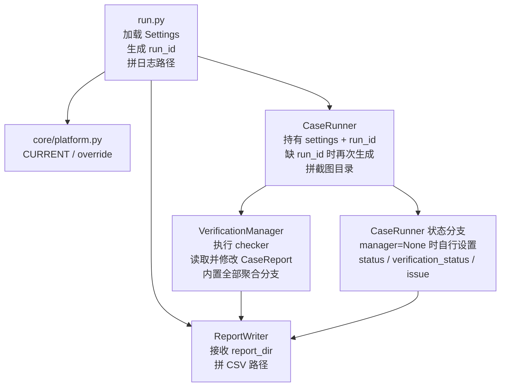
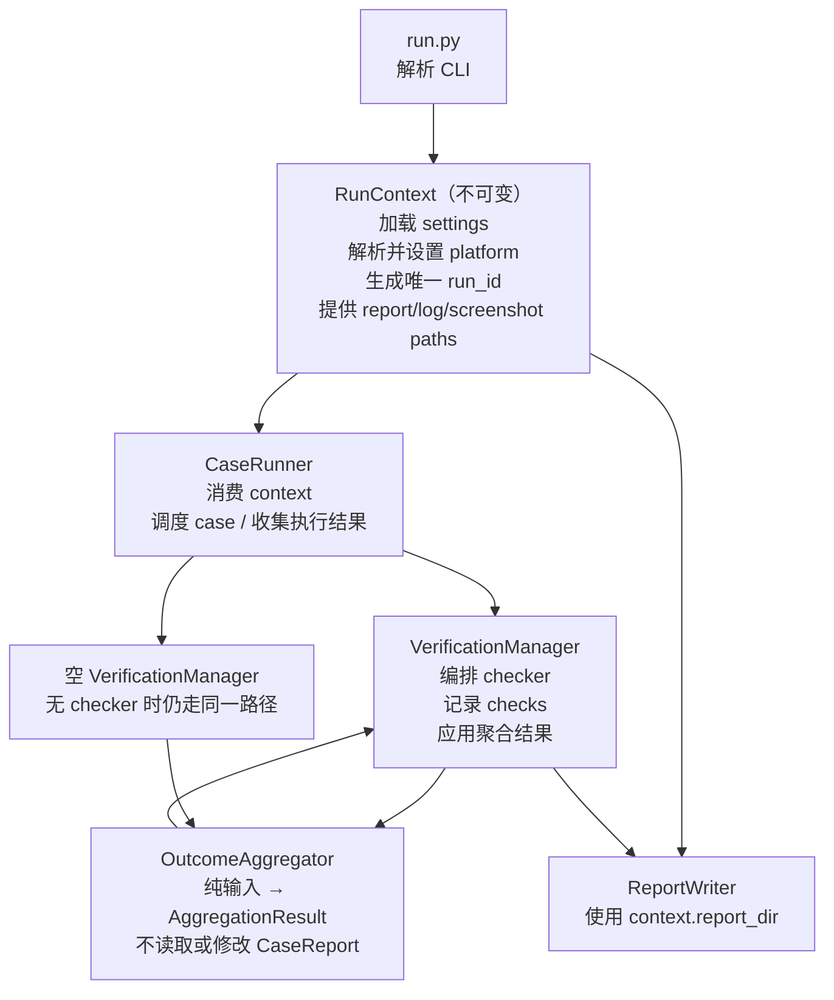

# 运行上下文与验收聚合架构对比

## 1. 范围与基线

- 对比基线：`1c3a51729e4acb6771d4e82423b22f2f648effd6`
- 目标：消除运行元数据/产物路径的重复推导，以及 Runner/Manager 的重复状态修改。
- 约束：不改变 case 执行顺序、checker 时机、聚合策略、报告字段、CLI 返回码和产物命名。
- 回滚点：上述基线提交可恢复本次解耦前的代码与文档。

## 2. 优化前

主要问题：

| 关注点 | 优化前状态 |
|--------|------------|
| 运行身份 | CLI 与 Runner 都具备生成 `run_id` 的能力 |
| 产物路径 | 日志、CSV、截图分别在入口、Writer、Runner 中拼接 |
| 平台初始化 | Agent 装配时才处理 override，已导入的 `CURRENT` 可能是旧值 |
| 验收聚合 | Manager 同时编排 checker、计算结论、修改报告 |
| 空验收 | Runner 在 `manager=None` 时维护另一套最终状态逻辑 |
| 可测试性 | 聚合规则只能通过可变 `CaseReport` 和 Manager 间接测试 |

## 3. 优化后

职责边界：

| 模块 | 只负责 | 不再负责 |
|------|--------|----------|
| `RunContext` | 本次运行的配置、平台、ID 和路径派生 | Agent/Writer/Checker 装配与生命周期 |
| `CaseRunner` | case 调度、步骤执行、收集执行证据 | 生成 run_id、拼产物路径、独立计算最终状态 |
| `VerificationManager` | checker 编排、容错、记录、应用结果 | 实现聚合规则 |
| `OutcomeAggregator` | 依据显式输入纯计算最终结论 | 运行 checker、访问或修改报告对象 |

## 4. 行为不变量

| 场景 | 解耦前后共同结果 |
|------|------------------|
| 执行 `failed/error/skipped` | 执行状态优先，验收记 `skipped` |
| 未启用控制面 checker | 最终 `inconclusive` |
| 任一已启用 checker 失败 | 最终 `failed` |
| 存在 missing/inconclusive/mock | 最终 `inconclusive` |
| 所有已启用 checker 通过 | 最终 `passed` |
| 服务端 mock | 仅验证链路，固定 `inconclusive` |
| 产物格式 | run_id、CSV 列、日志名、截图目录格式不变 |

> 聚合语义已于 2026-07-27 收敛为「所有已启用 checker 全过才通过」这一种（删除 `any_pass`/`strategy`）。详见 [tech_design.md](./tech_design.md) Changelog。

## 5. 验证与回滚

回归测试覆盖：

- `RunContext.new_run_id()` 唯一性及 CSV/日志/截图路径派生。
- 执行失败优先、无控制面验收、所有已启用 checker 全过才通过。
- mock 不通过、Judge 不重做非幂等动作、CSV 拒绝覆盖。

如需整体回滚，以 `1c3a51729e4acb6771d4e82423b22f2f648effd6` 为代码回滚点；运行数据无需迁移，因为报告结构和产物命名未变。
